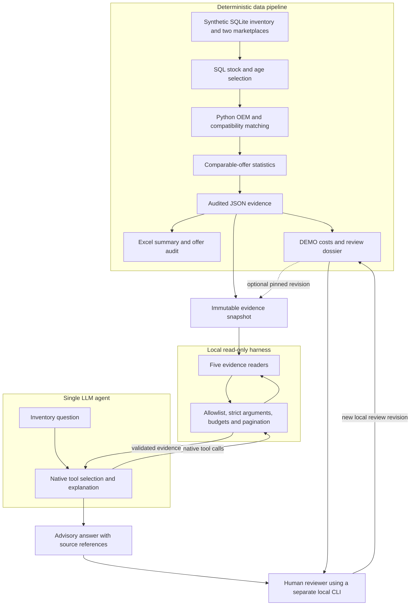

# OEM Intelligence Agent

A demonstrative AI agent system for reviewing aging automotive stock, checking OEM and compatibility evidence, and answering inventory questions through controlled access to audited data.

**All inventory, vehicle references, marketplace offers, prices and costs are synthetic. A human reviewer retains decision authority.**

## The Business Problem

Aging automotive stock creates a review problem before it creates a pricing decision. A part may have an uncertain OEM reference, incomplete vehicle compatibility details or market listings that are unsuitable for comparison.

An inventory reviewer needs to establish:

- Which in-stock pieces fall within the review window?
- Do offers match the exact OEM and the declared part/vehicle attributes?
- How many comparable listings and available units are known, and what prices do they show?
- Is the evidence sufficient, missing or incomplete because a source failed?
- What can be explained now, and what still requires human review?

OEM identity and compatibility are separate classifications. A successful search with no offers and a failed marketplace read are different evidence states. Neither establishes that the inventory catalog is wrong.

## How It Works

1. **Select inventory with SQL.** Include every piece with stock greater than zero and age between 60 and 90 days, inclusive, using configurable bounds. The current Stage 2 fixture returns 27 selected pieces without a result cap.
2. **Compare two synthetic marketplaces.** Python checks literal OEM identity separately from agreement on part name, brand, model and version. Exact/different/unknown OEM states remain distinct from confirmed/incompatible/unknown compatibility.
3. **Calculate market evidence deterministically.** Comparable prices require exact OEM, confirmed declared compatibility, valid positive prices and available stock. Observed extrema are separate from filtered extrema. Configurable DEMO P10/P90 filtering uses linear interpolation and a default minimum of 10 unique usable offers. Exclusions and identifiable duplicates remain auditable; missing prices stay `null`.
4. **Prepare review outputs.** Export JSON evidence and optional Excel summary, offer audit, trace and configuration sheets. A separate deterministic step produces eligible DEMO cost estimates and local review dossiers. Source errors or insufficient samples block those estimates.
5. **Let a bounded LLM inspect the results.** A single agent selects native tool calls over immutable evidence snapshots and an optional review revision. The local harness validates requests and enforces permissions, pagination, call/time/context limits and provider budgets. The evaluated hosted path uses Groq Free with `qwen/qwen3.8-27b` and the versioned `oem-evidence-review` skill.
6. **Keep the decision with a person.** The answer is advisory and includes resolvable source references. An operator records decisions through a separate local CLI, including responsible person, reason, timestamp and evidence fingerprint. Changed evidence invalidates prior approvals.

SQL/Python supplies the numbers; the LLM selects evidence reads and explains results. The agent cannot approve dossiers or change inventory or prices.

## Practical Example

**Existing synthetic evaluation case E1:** part `1001`, `AlternadorEval`, OEM **`0000421001`**. The fixture has one unit in stock aged 60 days, with vehicle fields `MarcaEval / ModeloEval / BaseEval`.

The question compares a **hypothetical price of EUR 190** with the DEMO filtered band. That price comes from the evaluation question; it is not a stored inventory selling price.

| Deterministic evidence | Recorded value |
| --- | --- |
| Comparable listings before filtering | 10 |
| Available units across those listings | 55 |
| Observed unit-price minimum / maximum | EUR 10 / EUR 100 |
| DEMO P10 / P90 cutoffs | EUR 19 / EUR 91 |
| Listings / units retained after filtering | 8 / 44 |
| Filtered unit-price minimum / maximum | EUR 20 / EUR 90 |
| Source coverage | Complete for both synthetic marketplaces |

An additional listing with OEM `00004210010` remains audited and excluded. Prefix similarity does not satisfy exact OEM equality. Percentile cutoffs also differ from the minimum and maximum prices of the retained offers.

For this question, the authored assessment is `possible_price_anomaly_demo`: the hypothetical price exceeds the filtered band and observed maximum. It calls for review, not a commercial price recommendation or catalog-error diagnosis.

The recorded real E1 run selected `inspect_case` for statistics and inventory, then returned a complete answer matching **all 10 expected structured fields**, using skill **1.0.1**. References resolve to the case and statistics configuration. The table above comes from deterministic evidence and includes audit details beyond the ten scored answer fields.

The [fixture](oem_agent/stage5_eval_data.py), [supporting tests](tests/test_stage5_evaluation.py) and [evaluation record](docs/STAGE_5_5.md) make these values inspectable. The offline evaluator below reproduces the scripted checks, not the historical hosted inference.

## Architecture



SQL, matching, statistics, exports, DEMO cost gates and scripted evaluation work offline. Hosted inference sends the authorized synthetic question, instructions, schemas and consulted evidence projections to Groq; tools and evidence access execute locally.

| Read tool | Responsibility |
| --- | --- |
| `summarize_run` | Summarize selected evidence and source coverage. |
| `list_cases` | Page through pieces or existing DEMO cost/review status. |
| `inspect_case` | Read inventory, aggregated matching, statistics or source traces for a selected piece. |
| `list_offers` | Inspect granular offer-audit rows, including excluded offers. |
| `review_status` | Read effective human-review state against the pinned evidence. |

The [contracts](oem_agent/stage5_contracts.py) and [dispatcher](oem_agent/stage5_dispatcher.py) enforce permissions. Invalid attempts consume budget. Unfinished pages, evidence errors and exhausted budgets prevent a complete execution. Matching aggregates retain unique offer identities and references; granular rows remain available.

The [single versioned skill](oem_agent/skills/oem-evidence-review/SKILL.md), currently **1.0.2**, supplies compact instructions without granting permissions. Traces retain tool requests/results, evidence fingerprints, configuration identity, timing, errors and reported token usage separately from estimated reservations. Transport traces omit authentication headers and private model reasoning.

Human review uses `oem_agent.stage4`, a separate operator CLI. Review records are local demonstration files, without authenticated user identity or ERP integration.

## Quick Start

Requires **Python 3.11+** and Git. Clone the repository and enter its root:

```text
git clone https://github.com/MatiasMaher78/oem-intelligence-agent.git
cd oem-intelligence-agent
```

Install the existing Excel extra to run the complete test suite, including the 11 XLSX export tests. These commands need **no API key, `.env`, running model or paid inference service**. Installation may download packages from the Python package index.

### Windows PowerShell

```powershell
python -m venv .venv
.\.venv\Scripts\python.exe -m pip install -e ".[excel]"
.\.venv\Scripts\python.exe -m oem_agent.stage2 seed-stats --db data/portfolio-stats.sqlite
.\.venv\Scripts\python.exe -m oem_agent.stage2 stats --db data/portfolio-stats.sqlite --excel runs/portfolio-01/market-evidence.xlsx
.\.venv\Scripts\python.exe -W error::ResourceWarning -m unittest discover -s tests -v
.\.venv\Scripts\python.exe -m oem_agent.stage5_eval offline --out runs/portfolio-eval-01
```

### Linux

```bash
python3 -m venv .venv
./.venv/bin/python -m pip install -e ".[excel]"
./.venv/bin/python -m oem_agent.stage2 seed-stats --db data/portfolio-stats.sqlite
./.venv/bin/python -m oem_agent.stage2 stats --db data/portfolio-stats.sqlite --excel runs/portfolio-01/market-evidence.xlsx
./.venv/bin/python -W error::ResourceWarning -m unittest discover -s tests -v
./.venv/bin/python -m oem_agent.stage5_eval offline --out runs/portfolio-eval-01
```

On Linux, install your distribution's Python venv support first if unavailable.

`seed-stats` creates the separate 27-piece demonstration fixture, including its sufficient-sample case at ID 10. `stats` prints audited JSON and exports Excel. The evaluator separately builds the five E1-E5 fixtures, including example part 1001, and exports evidence, dossiers, scripted traces, scores and negative-control results under `runs/portfolio-eval-01/`.

Existing databases, Excel files and evaluation output directories are protected against replacement. Choose new `--db`, `--excel` and `--out` paths on repeat runs. Generated files stay excluded from Git.

For dossier creation and operator decisions, follow the [human-review CLI documentation](docs/DELIVERY_04.md). Real LLM execution requires separate credentials, synthetic-data transfer authorization and current provider/quota checks; see the [Groq guide](docs/STAGE_5_3_GROQ.md). The offline evaluator uses explicitly scripted protocol responses.

## Validation

The recorded baseline includes Windows/Python 3.13 and a successful Ubuntu/Python 3.11 [GitHub Actions run](https://github.com/MatiasMaher78/oem-intelligence-agent/actions/runs/42390123816). CI installs Excel and runs the complete suite and offline evaluator.

| Validation | Scope | Recorded result |
| --- | --- | --- |
| Stage 5.5 closure tests | Pipeline, matching, statistics, exports, review, readers, harness and simulated provider protocols | **359/359 passed**, zero skips; all **11 Excel export tests** executed |
| Later local regression | Inventory-report presentation checks added; Windows/Python 3.13 | **367/367 passed**, zero skips; local pre-commit verification, no new CI execution |
| Offline scenarios | Five independent synthetic cases with authored deterministic ground truth | **5/5 passed** |
| Offline negative controls | Forbidden tools, malformed arguments, missing evidence, pagination, budget and simulated provider failures | **12/12 passed** |
| Real E1 | Groq Free, `qwen/qwen3.8-27b`, skill **1.0.1** | **Approved**; complete final answer, **10/10 expected structured fields** |
| Real E2 | Same model, skill **1.0.2** | **Partial / not approved**; additional exploration and preventive quota block |
| Real E5 | Same model, skill **1.0.2** | **Partial / not approved**; blocked before the model received tool results |

See the [evaluation reference](docs/EVALUATION.md) for the recorded scopes, reproduction commands and limitations.

The five cases cover a possible price anomaly, incompatible/uncertain offers, a price inside a DEMO band, absence of offers and a marketplace error. They are independent of the 27-piece fixture.

Offline passes demonstrate deterministic correctness and protocol/control behavior, not real-model accuracy. Real rows describe the latest recorded run per case; earlier partial attempts remain documented. E1's earlier skill differs from the current skill. E2/E5 produced no final answer and remain closed without further optimization or inference. No statistical reliability estimate or measured cost/productivity improvement is claimed.

## Technical Documentation

| Read next | Contents |
| --- | --- |
| [Architecture](docs/ARCHITECTURE.md) | Current pipeline, agent and harness; the original demo is explicitly separated. |
| [Engineering decisions](docs/DECISIONS.md) | Deterministic rules, controlled tool access, provenance and evaluation choices. |
| [Evidence readers and contracts](docs/STAGE_5_1.md) / [Harness controls](docs/STAGE_5_2.md) | Immutable snapshots, five read contracts, bounds, errors and pagination. |
| [Context, skill and references](docs/STAGE_5_4.md) | Instruction ownership, configuration identity and reference semantics; its skill version is a historical milestone. |
| [Evaluation](docs/EVALUATION.md) | Closed 5.5 results, later local regression, offline reproduction and limited real-agent evidence. |
| [Delivery and experiment history](docs/history/README.md) | Dated technical records, original demo and retained local-model experiments. |
| [Groq setup and recorded inference](docs/STAGE_5_3_GROQ.md) | Explicit provider selection, credentials, Free quota controls and historical real runs. |

Implementation history remains available in [selection](docs/DELIVERY_01.md), [matching](docs/DELIVERY_02.md), [statistics and Excel](docs/DELIVERY_03.md), [DEMO costs and human review](docs/DELIVERY_04.md), and [local Ollama experiments](docs/STAGE_5_3.md). The original `python -m oem_agent seed` / `run --mode rules` demo and optional two-tool SDK reviewer remain isolated from the current five-tool agent; see [architecture](docs/ARCHITECTURE.md). Code is available under the [MIT license](LICENSE).

## Limitations

- **Synthetic evidence only.** The two marketplaces are independent fixtures, without live scraping, production inventory feeds or measured real-market coverage.
- **Declared compatibility only.** Agreement on fixture fields does not establish real vehicle fitment. Missing offers and source failures do not diagnose catalog defects.
- **Demonstrative statistics and costs.** P10/P90 and the minimum sample are configurable demonstration rules, without established representativeness or statistical confidence. Cost parameters and formulas are invented.
- **Limited real-agent evaluation.** One scenario has an approved real answer. E2/E5 remain partial; the small, mixed-skill sample cannot establish general accuracy or reliability.
- **Bounded execution can stop early.** Provider quotas, conservative reservations, context limits and tool budgets can prevent a final answer. Missing balances remain unknown and local limits still apply. There is no automatic paid-provider fallback.
- **Source integrity is not semantic verification.** References resolve to pinned evidence, while explanations and claim-to-source interpretation still require human review.
- **Human control remains explicit.** The agent has no shell, free-form SQL, inventory/price writes, approval tool or automatic commercial action. Local review records do not authenticate the declared reviewer; production controls are outside this demonstration.
