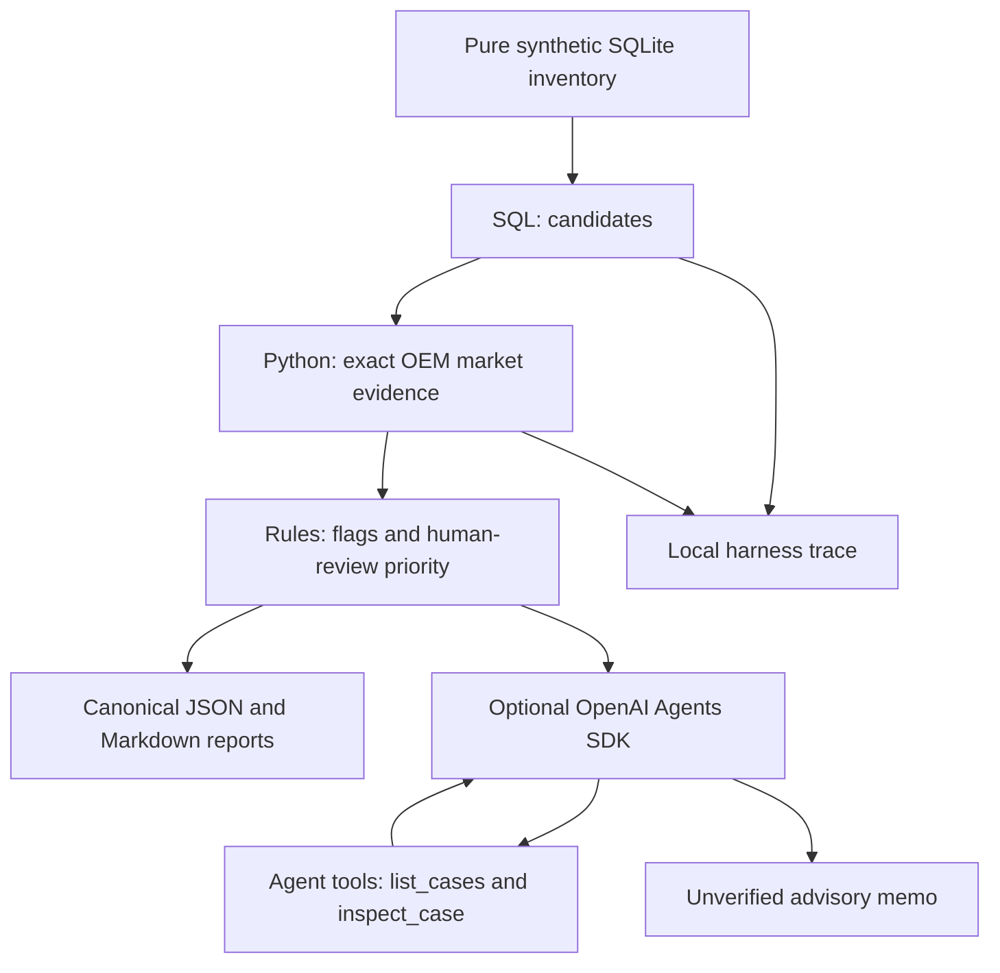

# Architecture and explicit agent anatomy

The diagram and first interfaces below describe the isolated original demo.
The current five-tool agent is described in the Stage 5 sections.

## Original demo

The offline `rules` mode is a **deterministic workflow, not an LLM agent**.
The `llm` mode introduces a model with tools and an execution loop managed by the Agents SDK.

## Tool interfaces
- `list_candidates(conn, days, limit)`: selects with parameterized SQL and hard cap.
- `market_evidence(conn, oem)`: exact matching; returns evidence and min/max/units.
- `list_cases()`: LLM-facing, precomputed summaries only.
- `inspect_case(inventory_id)`: LLM-facing, restricted to selected candidate IDs.

## Harness safety
- DB connection uses URI `mode=ro` plus `PRAGMA query_only`.
- Local explicit allowlist and tool-call budget: max candidates + one lookup.
- Optional SDK max_turns=8; tool access restricted to precomputed evidence.
- Reports never overwrite nonempty output directory.
- Synthetic fixture only. No network market lookup. No database write tool.
- Tracing to external SDK provider disabled in LLM demo by default to avoid exporting data; local workflow writes `trace.jsonl`.
- A scheduler *triggers* workflow, it is not the same as an agent.

## Stage 2 Delivery 01

Stage 2 [Delivery 01](DELIVERY_01.md) adds `oem_agent.stage2` and `stage2_db`
without altering the original pipeline. Its separate database contains inventory
identity/vehicle fields and two identifiable marketplace fixtures. A single
allowlisted read selects all in-stock pieces in an inclusive age range and
emits JSON source evidence plus SQL/parameter trace. It reuses the existing
read-only connection and harness; marketplace analysis is deferred.

## Stage 2 Delivery 02

[Delivery 02](DELIVERY_02.md) adds `stage2_matching` and the `stage2 match` CLI.
It reuses the same inventory selector, schema and fixtures, querying each source
by exact OEM or exact piece name. Python evaluates independent OEM and declared
compatibility axes and preserves every selected piece. Each query has SQL,
parameters and success/error trace evidence; failed source reads produce partial
coverage rather than empty-success claims. Cataloguing remains unassessed.

## Stage 2 Delivery 03

[Delivery 03](DELIVERY_03.md) reuses matching in `stage3_statistics`, adding exact
percentiles and a complete source-offer audit read. `stage3_fixtures` supplies a
separate sufficient-sample database. `excel_export` is an optional presentation
adapter with exclusive file creation; the numerical pipeline has no new runtime
dependency. Source/matching evidence is preserved alongside calculation traces.

## Stage 2 Delivery 04

Delivery 04 [local review](DELIVERY_04.md) consumes the structured Delivery 03
artifact in `stage4_review`, without further inventory SQL or mutations. Pure
DEMO cost calculations are gated by audited evidence; `stage4` writes new JSON
review revisions with operator decisions, evidence/parameter hashes, review
epochs and parent/history links. Every effective approval checks current evidence.

## Stage 5 increment 5.1

`stage5_evidence.EvidenceSnapshot` pins validated Delivery 03 evidence and an
optional Delivery 04 revision as immutable canonical JSON bytes. It retains
Delivery 01 selection, Delivery 02 matching and subsequent audit/history rather
than querying DBs again. `stage5_contracts` describes five strict read contracts;
direct projections have explicit pagination, source references and query traces.
No agent loop, model adapter, CLI or harness budget changes are part of 5.1.
See [increment documentation](STAGE_5_1.md).

## Stage 5 increment 5.2

`stage5_dispatcher.ReadOnlyDispatcher` wraps the five read projections with the
unchanged `Harness`. It records attempts before validation, restricts permissions,
tracks errors and pagination, blocks repeated reads and validates bounded results.
Only explicit finalization can mark a clean, nonexhausted session complete.
Outer traces retain rejected calls and errors; operator-only JSON exports use
exclusive creation. Calls are serialized; time limits are cooperative and late
results are withheld. No model adapter, CLI or new dependency is introduced.
See [increment documentation](STAGE_5_2.md).

## Stage 5 increment 5.3

`ollama_local` restricts transport to the loopback native API, checks disabled
cloud/local-model identity and enforces request/context limits. `stage5_agent`
lets one Qwen3:4b model select native tools, returning dispatcher projections to
the conversation; no business-question router exists. Observable audits exclude
private thinking/intermediate content. The opt-in example prepares three real
questions with operator-provisioned weights. Protocol simulations precede real
inference; the original optional SDK demo remains isolated and is never a fallback.
See [increment documentation](STAGE_5_3.md).

The explicitly selected `groq_hosted` adapter shares that conversation loop via
`run_groq_agent`. It translates native Groq argument strings/IDs to the existing
dispatcher representation and returns the same local evidence projections. Its
fixed HTTPS destination is independent of the unchanged loopback-only client;
neither adapter falls back to the other. Recent operator-confirmed Free quota
and synthetic-data transfer authorization are required before inference. The
account plan cannot be certified by the model catalog API. The third-query fix
adds an optional paginated cost-review view to list_cases, reusing dossier_view,
with lossless grouped model projections and measured-prefix prompt estimates.
Original defaults and five tool names remain; the dispatcher adds only missing-
dossier handling for this view. No SQL, business-rule, review-decision or permission
changes. The smoke CLI explicitly loads only
GROQ_API_KEY/GROQ_MODEL from the ignored root .env via the small standard-library
`groq_config` loader; an offline mode exposes availability booleans without network.
See [Groq preparation](STAGE_5_3_GROQ.md).

## Stage 5 increment 5.4

The sole runtime instruction source is the packaged, versioned
`oem_agent/skills/oem-evidence-review/SKILL.md`. `stage5_context` loads its body
once; AGENTS.md, history documents, frontmatter and retired skills never enter
model context. The existing shared native loop and five contracts are unchanged.

Every report binds the actual skill/prompt, schemas, selected provider/model and
safe effective limits to a configuration version/hash. The existing detailed
traces retain tools, real/estimated tokens, timing and sanitized failures.
Accepted tool references are deduplicated and resolved in the immutable snapshot,
attached as answer_references and identified by local R labels in the answer.
Missing/invalid sources prevent a complete answer. Reference integrity does not
validate model claims; advisory_only/answer_verified=false and partial coverage
semantics are retained. See [5.4 details](STAGE_5_4.md).

## Stage 5 increment 5.5

The independent evaluation fixture builds five one-piece synthetic databases with
existing SQL, matching and statistics, then pins snapshots/dossiers. Its explicit
source fault is confined to fixture construction. SQL, matching classifications,
prices, percentiles, DEMO costs and human-review rules remain unchanged.

Authorized follow-ups changed read projections and observability: tool responses
omit redundant session metadata from the first read while retaining business
facts, IDs, coverage, errors and resolvable references. The full dispatcher audit
is preserved locally. `inspect_case(section=matching)` adds an exhaustive summary
of unique source/offer identities by the already audited OEM/compatibility labels,
with counts, IDs, scope, coverage and references; `list_offers` retains every
original granular row. No new tool or permission is introduced.

The single runtime skill is now 1.0.2. It explains summary versus granular reads
and asks the model to finish when all requested dimensions have sufficient
evidence. Tool choice remains native LLM selection, with no Python question
routing. Reservation events are recorded before preventive validation, separating
estimated prompt/output/safety reservations from real provider usage and observed
remaining quota. The existing 8000 TPM and other Free/harness bounds are preserved;
a block cannot be presented as a complete execution.

The operator-side evaluator scores authored finite facts, necessary native reads,
references, source coverage, errors/limits and trace/configuration integrity.
Closure: 359/359 tests, 5/5 scripted scenarios and 12/12 negative controls; E1 real
approved (10/10 fields, skill 1.0.1), E2/E5 real partial/not approved (skill 1.0.2).
Offline success does not measure LLM accuracy. Source references do not establish
semantic correctness, and the small real sample supports no reliability estimate.
An E5 final answer can explain partial source coverage, but this real run stopped
before the model received tool results. No automatic commercial operation exists.
See [evaluation details and historical records](STAGE_5_5.md).

## Upgrade paths (do not implement prematurely)

1. Evals: expected candidate IDs, price extrema, error scenarios and LLM grounding rubric.
2. Persistence and idempotency for multi-run schedulers.
3. Data ingestion from authorized public/owned sources, with rate limits and Terms review.
4. HITL approval gateway for changes, entirely separate from analysis tools.
5. Tool-level retry, timeout, circuit breaker, cost/token budget, metrics.
6. Anomaly-based escalation with observability and alerts.
