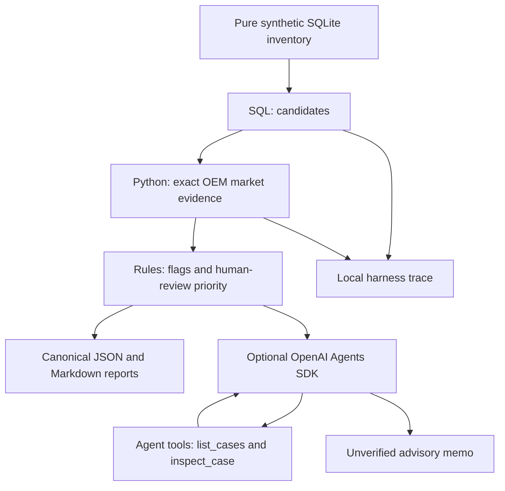

# Architecture and explicit agent anatomy

The offline `rules` mode is a **deterministic workflow, not an LLM agent**.
The `llm` mode introduces a model with tools and an execution loop managed by the Agents SDK.

## Tool interfaces
- `list_candidates(conn, days, limit)`: selects with parameterized SQL and hard cap.
- `market_evidence(conn, oem)`: exact matching; returns evidence and min/max/units.
- `list_cases()`: LLM-facing, precomputed summaries only.
- `inspect_case(inventory_id)`: LLM-facing, restricted to selected candidate IDs.

## Harness safety
- DB connection uses URI `mode=ro` plus `PRAGMA query_only`.
- Local explicit allowlist and tool-call budget: max candidates + one lookup.
- Optional SDK max_turns=8; tool access restricted to precomputed evidence.
- Reports never overwrite nonempty output directory.
- Synthetic fixture only. No network market lookup. No database write tool.
- Tracing to external SDK provider disabled in LLM demo by default to avoid exporting data; local workflow writes `trace.jsonl`.
- A scheduler *triggers* workflow, it is not the same as an agent.

## Stage 2 Delivery 01

Stage 2 [Delivery 01](DELIVERY_01.md) adds `oem_agent.stage2` and `stage2_db`
without altering the original pipeline. Its separate database contains inventory
identity/vehicle fields and two identifiable marketplace fixtures. A single
allowlisted read selects all in-stock pieces in an inclusive age range and
emits JSON source evidence plus SQL/parameter trace. It reuses the existing
read-only connection and harness; marketplace analysis is deferred.

## Stage 2 Delivery 02

[Delivery 02](DELIVERY_02.md) adds `stage2_matching` and the `stage2 match` CLI.
It reuses the same inventory selector, schema and fixtures, querying each source
by exact OEM or exact piece name. Python evaluates independent OEM and declared
compatibility axes and preserves every selected piece. Each query has SQL,
parameters and success/error trace evidence; failed source reads produce partial
coverage rather than empty-success claims. Cataloguing remains unassessed.

## Stage 2 Delivery 03

[Delivery 03](DELIVERY_03.md) reuses matching in `stage3_statistics`, adding exact
percentiles and a complete source-offer audit read. `stage3_fixtures` supplies a
separate sufficient-sample database. `excel_export` is an optional presentation
adapter with exclusive file creation; the numerical pipeline has no new runtime
dependency. Source/matching evidence is preserved alongside calculation traces.

## Stage 2 Delivery 04

Delivery 04 [local review](DELIVERY_04.md) consumes the structured Delivery 03
artifact in `stage4_review`, without further inventory SQL or mutations. Pure
DEMO cost calculations are gated by audited evidence; `stage4` writes new JSON
review revisions with operator decisions, evidence/parameter hashes, review
epochs and parent/history links. Every effective approval checks current evidence.

## Stage 5 increment 5.1

`stage5_evidence.EvidenceSnapshot` pins validated Delivery 03 evidence and an
optional Delivery 04 revision as immutable canonical JSON bytes. It retains
Delivery 01 selection, Delivery 02 matching and subsequent audit/history rather
than querying DBs again. `stage5_contracts` describes five strict read contracts;
direct projections have explicit pagination, source references and query traces.
No agent loop, model adapter, CLI or harness budget changes are part of 5.1.
See [increment documentation](STAGE_5_1.md).

## Upgrade paths (do not implement prematurely)

1. Evals: expected candidate IDs, price extrema, error scenarios and LLM grounding rubric.
2. Persistence and idempotency for multi-run schedulers.
3. Data ingestion from authorized public/owned sources, with rate limits and Terms review.
4. HITL approval gateway for changes, entirely separate from analysis tools.
5. Tool-level retry, timeout, circuit breaker, cost/token budget, metrics.
6. Anomaly-based escalation with observability and alerts.
